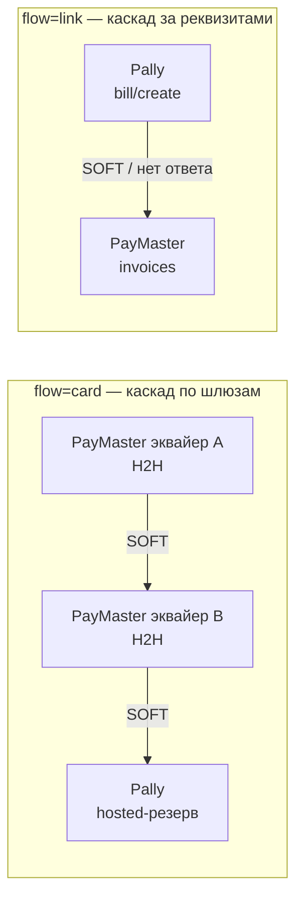
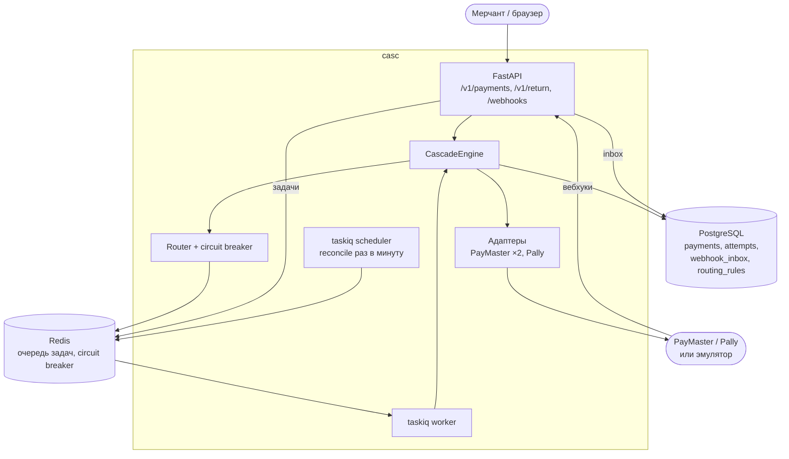
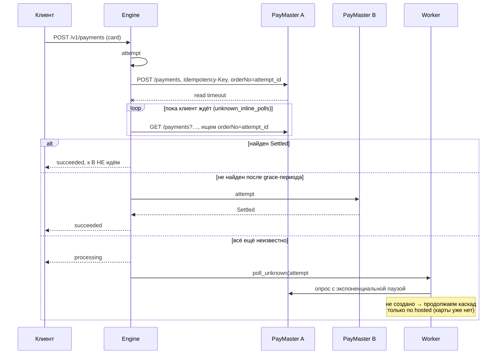
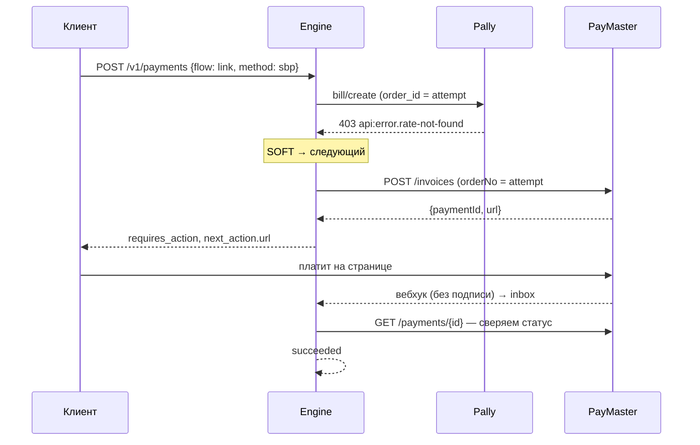
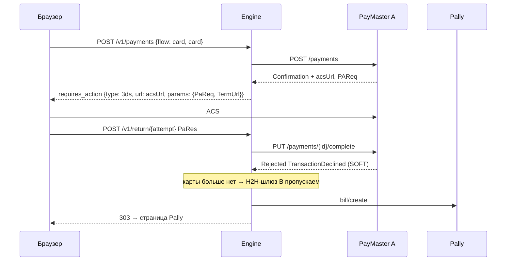
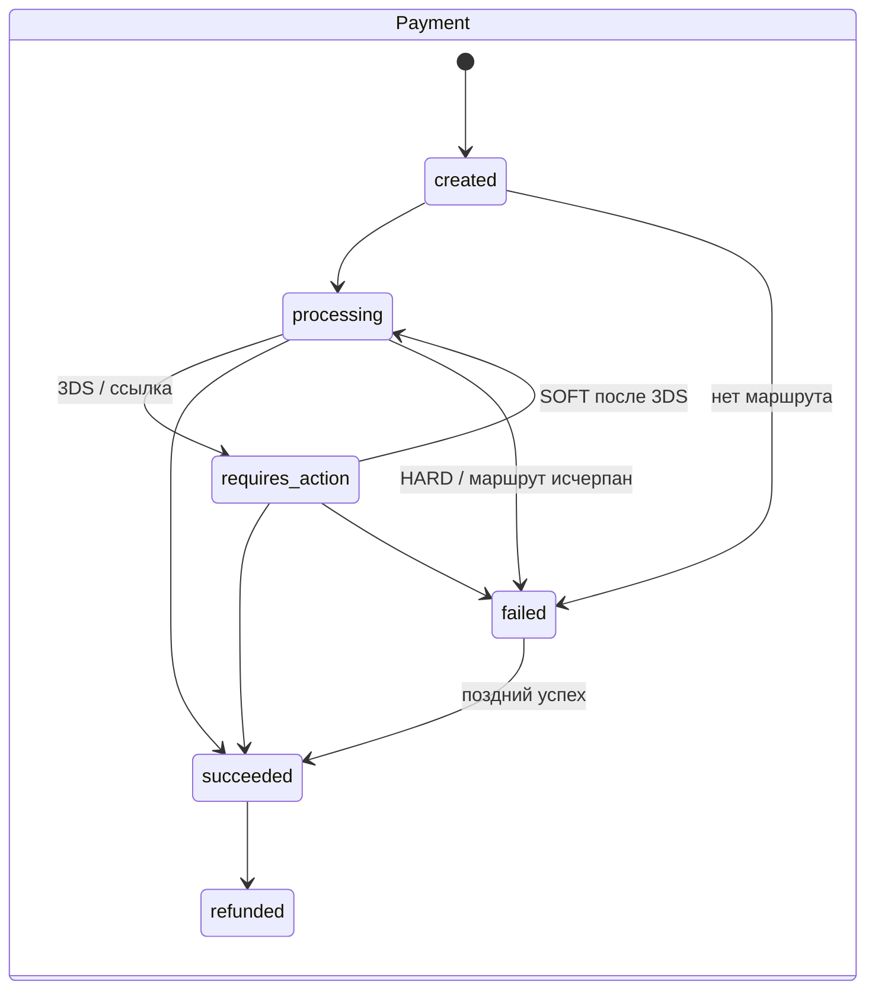
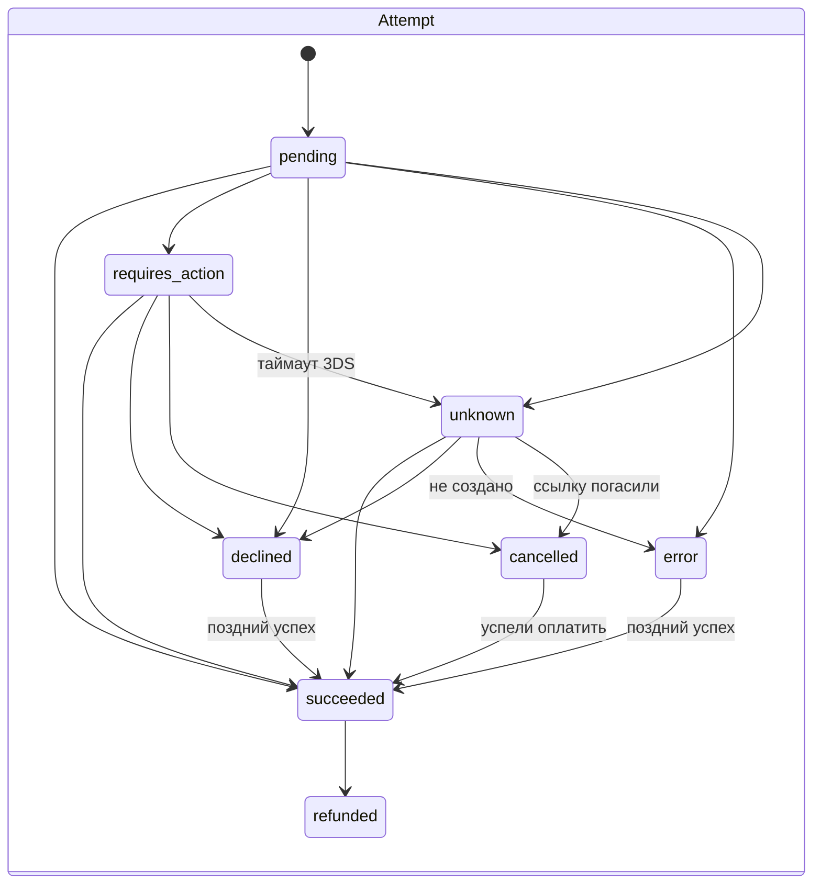

# Каскадирование платежей: дизайн

## 1. Задача и термины

**Каскадирование** — мерчант подключён к нескольким платёжным провайдерам. Если провайдер не смог
провести платёж или выдать реквизиты, система автоматически пробует следующего. Это даёт:

- **конверсию** — часть отказов вызвана не картой, а конкретным банком-эквайером или провайдером;
- **отказоустойчивость** — платёжный поток переживает падение провайдера;
- **экономию** — платёж идёт туда, где дешевле, а дорогой провайдер остаётся резервом.

Цена каскада — риски. Если пробовать слишком много, растёт доля отказов мерчанта у эмитентов. Если
переключаться не вовремя, можно **списать деньги дважды**. Поэтому основная часть дизайна — не
«перебрать провайдеров», а **когда переключаться нельзя**.

Провайдеры в проекте:

| Провайдер | Как принимает | Что важно для каскада |
|---|---|---|
| **PayMaster** API v2 | H2H: `POST /api/v2/payments` с картой. Hosted: `POST /api/v2/invoices` | Синхронный ответ со `status` и `resultCode`. Есть `Idempotency-Key` и 3DS (`Confirmation` → `/complete`). **Подпись вебхуков в документации не описана** |
| **Pally** API v1 | Только hosted: `POST /api/v1/bill/create` → ссылка | Результат приходит postback'ом с подписью `md5(OutSum:InvId:token)`. Есть `bill/search?order_id` и `bill/toggle_activity` |

Ключей к провайдерам нет. Адаптеры написаны строго по документации и проверены против эмулятора,
который повторяет пути и форматы обоих API (`app/emulator`).

## 2. Два режима каскада

**A. `flow=link` — каскад на этапе получения ссылки или реквизитов.** Клиенту нужно куда-то перевести
деньги: страница оплаты, СБП, P2P, крипта. Система запрашивает у провайдеров по приоритету ссылку или
реквизиты. Если провайдер вернул ошибку, недоступен или не ответил, запрос сразу уходит к следующему.
Если ошибка «у вас неправильные реквизиты», она сразу отдаётся клиенту. Денег на этом этапе ещё нет,
поэтому каскадить можно смело. Это основной режим, его поддерживают оба провайдера.

**B. `flow=card` — классический каскад по шлюзам.** Клиент ввёл карту и нажал «Оплатить». Сначала
пробуем провести платёж через шлюз 1, при мягком отказе сразу через шлюз 2, и клиент этого не
замечает. Напрямую принять карту умеет только PayMaster. Поэтому в маршруте два PayMaster-эквайера
(`paymaster_a` и `paymaster_b` — разные терминалы, как в жизни), а Pally стоит последним резервом через
переадресацию на его страницу.

Почему hosted всегда в конце маршрута: карту мы держим только в памяти одного HTTP-запроса и нигде не
сохраняем. После переадресации на страницу провайдера карты у нас больше нет, и автоматически
продолжить H2H-каскад невозможно.

## 3. Архитектура

| Компонент | Файл | Ответственность |
|---|---|---|
| Движок | `app/cascade/engine.py` | Цикл каскада, применение результатов, решения «дальше или стоп» |
| Классификация отказов | `app/domain/declines.py` | Коды провайдеров → `HARD`, `SOFT`, `CONFIG`, `UNKNOWN` |
| State machine | `app/domain/state_machine.py` | Допустимые переходы платежа и попытки |
| Роутинг | `app/routing/router.py` | Подходящие провайдеры по валюте, сумме и методу. Порядок: H2H → priority → комиссия |
| Circuit breaker | `app/routing/circuit_breaker.py` | 3 технических сбоя за 60 с → провайдер исключается из маршрутов на 30 с |
| Адаптеры | `app/providers/*` | HTTP, маппинг ответов, разделение сетевых ошибок на «не дошло» и «неизвестно» |
| Inbox вебхуков | `app/cascade/inbox.py` | Дедупликация, асинхронная обработка |
| Фоновые задачи | `app/worker/tasks.py` | Выяснение UNKNOWN, гашение осиротевших ссылок, возврат дублей, reconcile, чистка старых данных |
| Метрики | `app/api/metrics.py` | `GET /metrics` в формате Prometheus (раздел 12) |

## 4. Модель данных

- **`payments`** — намерение клиента заплатить. Хранит `idempotency_key` (UNIQUE) и `request_hash`, 
  `route_snapshot` (маршрут фиксируется при создании, правила потом могут измениться), `deadline_at`
  и `succeeded_attempt_id` (UNIQUE FK).
- **`payment_attempts`** — одна попытка у одного провайдера. Хранит `seq`, `provider`, `mode`, `stage`
  (`link`/`charge`), `status`, `decline_code`, `decline_class`, `next_action`, `is_duplicate`,
  `raw_response` (без PAN и CVC).
  **`id` попытки уходит провайдеру как `order_id` или `orderNo`.** По нему мы находим операцию у
  провайдера, даже если не получили ответ.
- **`webhook_inbox`** — входящие уведомления. Хранит UNIQUE(`provider`, `dedup_key`) и
  `processed_at`.
- **`outbox`** — фоновые задачи, записанные в той же транзакции, что и новое состояние (раздел 6, п. 9).
- **`routing_rules`** — участие провайдера в режиме: `flow`, `mode`, `priority`, валюты, методы,
  лимиты суммы, комиссия.

`payments.succeeded_attempt_id` — единственный источник правды о том, через кого прошли деньги. Это
одна колонка, поэтому две «засчитанные» попытки у платежа невозможны физически.

## 5. Классификация ответов

| Класс | Что значит | Действие | Примеры |
|---|---|---|---|
| **HARD** | Проблема в карте или запросе: у другого провайдера будет так же, или повтор вреден | **Стоп**, ошибка клиенту | `InsufficientFunds`, `InvalidAccount`, `BlockedAccount`, `ExpiredAccount`, `RejectedByFraud`, `ThreeDSecureFailed`, `CancelledByUser`, `PaymentCountExceeded`, `validation_error`, Pally `invalid_amount`, HTTP 422 |
| **SOFT** | Проблема конкретного провайдера, эквайера или терминала | Следующий провайдер | `TransactionDeclined` (аналог do_not_honor), `IssuerUnavailable`, `OperationNotAllowed`, `PaymentLimitExceeded`, `CardNotEnrolled`, Pally `rate-not-found`, `transaction_rejected`, 5xx, ошибка соединения |
| **CONFIG** | Сломана наша настройка у провайдера | Следующий провайдер + **алерт** | 401, `not_authorized`, `merchant_banned`, `ip_access_denied`, `access_denied` |
| **UNKNOWN** | Запрос ушёл, ответа нет | См. раздел 6 | read timeout, обрыв соединения, 500/502/504 на списании, статус `Pending` |

Неизвестный код считается SOFT: следующий провайдер сам решит. Фрод и «превышено число попыток»
отнесены к HARD намеренно. Повтор через другой шлюз в этих случаях — именно то поведение, за которое
эмитенты и МПС штрафуют мерчанта.

## 6. Защита от двойного списания

Главный принцип: **отличать «запрос точно не дошёл» от «не знаем, что случилось»**.

| Ситуация | Где | Решение |
|---|---|---|
| `ConnectError`, `ConnectTimeout` | любой этап | Запрос не дошёл → SOFT, можно каскадить |
| HTTP 503 | любой этап | По семантике HTTP запрос не принят в обработку → SOFT |
| HTTP 500/502/504, read timeout, обрыв, ошибка записи | **списание** | **UNKNOWN: не каскадим**, выясняем статус. Обычно это занимает 1–2 секунды |
| То же самое | **ссылка** | Денег нет → каскадим, осиротевший счёт гасим в фоне |
| Неожиданный ответ (не тот JSON, исключение в адаптере) | любой этап | UNKNOWN: попытка не остаётся навсегда в `PENDING` |

Что ещё страхует:

1. **Попытка пишется в БД до запроса** (`PENDING`). Если процесс упал во время HTTP-вызова, reconcile
   найдёт зависший `PENDING` и выяснит его судьбу у провайдера.
2. **`Idempotency-Key = {payment_id}:{seq}`** на каждый запрос к PayMaster. Сетевой ретрай не
   создаст второе списание.
3. **Блокировка платежа не держится во время HTTP-запроса.** Результат применяется отдельной
   транзакцией под `SELECT … FOR UPDATE`. Состояние меняется только по таблице переходов, поэтому
   устаревшие и повторные события тихо игнорируются.
4. **Решение о каскаде принимает только последняя попытка.** Отказ по старой попытке (например,
   по погашенной ссылке) на платёж не влияет.
5. **Поздний успех.** Деньги — факт, который важнее любого нашего вывода. Если провайдер сообщает
   об успехе по попытке, которую мы уже сочли отказом, ошибкой («не создано») или погашенной ссылкой,
   переход в `SUCCEEDED` разрешён всегда. Дальше:
   - платёж ещё не оплачен → засчитываем его (в том числе переводом `FAILED → SUCCEEDED`);
   - платёж уже оплачен через другую попытку → помечаем `is_duplicate`, пишем `ALERT` и ставим
     **автоматический возврат**.
6. **Осиротевшие ссылки.** Если по таймауту ушли к следующему провайдеру, первый мог всё-таки
   создать счёт. Воркер находит его (`bill/search?order_id=attempt_id` или
   `GET /payments?…orderNo`) и гасит (`toggle_activity active=0` или `PUT /payments/{id}/cancel`).
   У PayMaster-счёта к тому же короткий `invoice.expires`.
7. **После успешного платежа гасятся все висящие ссылки** других попыток, чтобы клиент не оплатил
   дважды.
8. **Transactional outbox.** Фоновая задача (выяснить UNKNOWN, погасить ссылку, вернуть дубль)
   записывается в таблицу `outbox` в **той же транзакции**, что и новое состояние попытки. После
   commit она сразу уходит в очередь и помечается отправленной. Если процесс или Redis упали между
   commit и постановкой, задача остаётся в БД, и reconcile досылает её. Доставка at-least-once,
   задачи идемпотентны, поэтому повтор безопасен.
9. **Reconcile раз в минуту** подбирает всё, что потерялось. Перед постановкой каждой задачи берётся
   Redis-лок, чтобы не плодить параллельные цепочки ретраев:
   - зависшие `PENDING` (процесс упал во время запроса);
   - `UNKNOWN` без вердикта;
   - платежи в `CREATED`/`PROCESSING` без запроса в полёте (процесс упал между шагами каскада) —
     каскад продолжается по hosted;
   - брошенные 3DS;
   - истёкшие ссылки;
   - неотправленные возвраты дублей;
   - необработанные вебхуки;
   - неотправленные задачи outbox.

## 7. Сценарии

### flow=link: провайдер не выдал реквизиты

### flow=card: 3DS, мягкий отказ после 3DS, hosted-резерв

### Отказ на hosted-странице

По умолчанию **не каскадим**: клиент уже ввёл данные и получил отказ, это почти наверняка решение
эмитента. Ещё одна попытка через другую ссылку только ухудшит статистику. Поведение включается
флагом `CASCADE_AFTER_HOSTED_DECLINE=true`.

## 8. State machine

## 9. Вебхуки

- **Inbox:** сохранить (UNIQUE(provider, dedup_key)) → ответить `200` → обработать в воркере.
  Повторная доставка того же события не обрабатывается дважды. Событие, которое не удалось поставить
  в очередь, подберёт reconcile.
- **Pally:** проверяем `SignatureValue` через `hmac.compare_digest`. Неверная подпись → `403`.
  Подпись `md5(OutSum:InvId:token)` **не покрывает поле `Status`**, поэтому статус всё равно сверяем
  через `GET /api/v1/bill/status`.
- **PayMaster:** механизм подписи в документации не описан. Подпись мы кладём **в сам callback URL**,
  который передаём провайдеру: `/webhooks/paymaster/{instance}/{attempt_id}/{hmac}`. Подделать
  вебхук или «отравить» дедупликацию без секрета нельзя. Содержимое вебхука при этом тоже не факт,
  статус берём из `GET /api/v2/payments/{id}`.
- Если API провайдера недоступен во время обработки, событие **не помечается обработанным**:
  задача повторится, а reconcile подберёт событие позже.
- **Возврат браузера** (`/v1/return/...?result=success`) — тоже не факт: статус сверяется с
  провайдером.

## 10. Идемпотентность API

`POST /v1/payments` требует заголовок `Idempotency-Key`:

- тот же ключ и то же тело → тот же платёж (`200`), без новой попытки;
- тот же ключ и другое тело → `409`;
- параллельные запросы с одним ключом → один платёж и одно списание (гонку разрешает UNIQUE-индекс).
  Это покрыто тестом `test_concurrent_requests_with_same_key_charge_once`.

## 11. Компромиссы и что сознательно упрощено

| Решение | Почему так | Что в проде |
|---|---|---|
| Карта проходит через наш сервис (H2H) | Без этого нет «невидимого» каскада по картам | PCI DSS или токенизация (hosted fields, токен провайдера, network tokens). PAN и CVC у нас не сохраняются и не логируются (`CardData.__repr__` маскирует) |
| `find_by_order` у PayMaster — перебор списка платежей за окно времени | В API нет поиска по `orderNo` | Уточнить у провайдера. Можно повторить исходный запрос с тем же `Idempotency-Key` |
| «Не найдено после grace-периода» = «не создано» | Иначе UNKNOWN висел бы вечно | Если операция появится позже, сработает логика позднего успеха (засчитать или вернуть) |
| Ретраи задач — `sleep` внутри воркера | `ListQueueBroker` не умеет отложенные задачи | Брокер с delay (RabbitMQ, `taskiq-redis` stream + scheduler) |
| Порядок по статическому `priority` | Достаточно для каскада | Smart routing по скользящей успешности, BIN, стоимости |
| Pally `UNDERPAID` = отказ + лог | Деньги частично пришли | Отдельный статус и ручной разбор |
| Метрики считаются запросами к БД (с кэшем 10 с) | Корректны для всех процессов, без новых зависимостей | При десятках миллионов строк: чтение с реплики или счётчики и гистограммы `prometheus_client` (multiprocess), формат ответа тот же |
| Лимит по карте — фиксированное окно | Простой атомарный `INCR` | Скользящее окно (Lua + sorted set), если нужна точность на стыке окон |
| `payment_attempts` не партиционируется | При объёмах тестового не нужно | Партиции по месяцам по `created_at` при десятках миллионов попыток |
| Нет аутентификации мерчантов в нашем API | Вне скоупа тестового | API-ключи или mTLS, мультитенантность |

## 12. Эксплуатация

**Метрики** (`GET /metrics`, формат Prometheus). Считаются агрегирующими `SELECT` по БД, поэтому видят и API, и воркеры. Читающие запросы не блокируют запись (MVCC). Нагрузку ограничивает кэш готового ответа в Redis на `METRICS_CACHE_SECONDS` (10 с): сколько бы ни было скрейперов и реплик, к БД идёт один набор запросов за это время.

| Метрика | Что показывает |
|---|---|
| `casc_payments{status}`, `casc_payments_total`, `casc_payments_cascaded` | Платежи и доля тех, что прошли каскадом |
| `casc_attempts{provider,status}` | Approval rate по провайдеру: `succeeded / sum(attempts)` |
| `casc_attempt_latency_ms_sum` / `_count` | Средняя задержка ответа провайдера |
| `casc_attempts_unknown` | Попытки с неизвестным исходом: **алерт, если растёт** |
| `casc_attempts_duplicate` | Двойные списания: **алерт на любое ненулевое значение** |
| `casc_webhook_inbox_unprocessed`, `casc_outbox_pending` | Очереди, которые должны быть близки к нулю |
| `casc_circuit_open{provider}` | Открыт ли circuit breaker |

Остальные алерты идут строкой `ALERT` в логах: неверная настройка у провайдера, двойное списание,
невыясненный исход, не погашенный осиротевший счёт.

**Лимит по карте.** Не больше `CARD_VELOCITY_LIMIT` платежей (по умолчанию 5) с одной карты за
`CARD_VELOCITY_WINDOW_SECONDS` (по умолчанию час), иначе `429`. Счётчик в Redis (атомарный `INCR` + TTL),
основные таблицы не нагружаются. Если Redis недоступен, платёж пропускается. Окно фиксированное,
на стыке окон возможен всплеск до 2×лимита. С каскадом это до 15 обращений к
эмитентам на карту, и сервис не превращается в инструмент перебора карт. Отпечаток карты — HMAC от
PAN, обычный хеш подбирается перебором, сам PAN нигде не хранится. Повтор запроса с тем же `Idempotency-Key` в лимит не
считается.

**Хранение.** Раз в сутки (`purge_old_data_task`) удаляются обработанные вебхуки старше 30 дней и
отправленные задачи outbox старше 7 дней. Необработанные записи не удаляются никогда. Платежи и
попытки хранятся бессрочно: это финансовая история.
